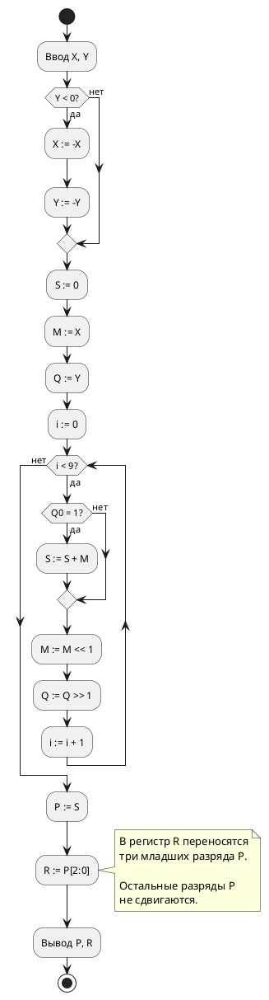

# Лабораторная работа №1  
## Изучение алгоритма выполнения целочисленной машинной операции умножения

## Дополнительная функция №2

После завершения операции умножения над полученным результатом необходимо выполнить дополнительную функцию:

> **Переместить три младших разряда результата в другой регистр, оставшиеся разряды не перемещать.**

Для реализации функции вводится дополнительный регистр `R` разрядностью 3 бита.

После завершения основного алгоритма результат умножения находится в регистре `P`.

В дополнительный регистр записываются три младших разряда результата:

$$
R := P[2:0]
$$

где:

- `P[0]` — младший разряд результата;
- `P[1]` — следующий разряд;
- `P[2]` — третий младший разряд.

При выполнении операции сдвиг регистра результата не производится. Остальные разряды результата сохраняют своё положение.

Например, если:

```text
P = 00000000000010010110
```

то три младших разряда равны:

```text
110
```

и после выполнения дополнительной функции:

```text
R = 110
P = 00000000000010010110
```

---

# Расширенный текстовый алгоритм

1. Получить исходные операнды `X` и `Y`.

2. Проверить знак множителя `Y`.

3. Если множитель отрицательный, изменить знак обоих операндов:

$$
X := -X
$$

$$
Y := -Y
$$

4. Обнулить сумму частичных произведений:

$$
S := 0
$$

5. Поместить множимое в рабочий регистр:

$$
M := X
$$

6. Поместить множитель в рабочий регистр:

$$
Q := Y
$$

7. Установить счётчик:

$$
i := 0
$$

8. Проверить младший разряд множителя `Q`.

9. Если:

$$
Q_0 = 1
$$

прибавить текущее множимое к сумме:

$$
S := S + M
$$

10. Сдвинуть множимое на один разряд влево:

$$
M := M << 1
$$

11. Сдвинуть множитель на один разряд вправо:

$$
Q := Q >> 1
$$

12. Увеличить счётчик:

$$
i := i+1
$$

13. Повторять пункты 8–12, пока не будут обработаны все 9 информационных разрядов множителя.

14. Сохранить произведение:

$$
P := S
$$

15. Выделить три младших разряда результата:

$$
R := P[2:0]
$$

16. Остальные разряды регистра `P` не сдвигать.

17. Вывести результат умножения `P` и содержимое дополнительного регистра `R`.

---

# Псевдокод расширенного алгоритма

```text
Ввод X, Y

если Y < 0 тогда
    X := -X
    Y := -Y
конец если

S := 0
M := X
Q := Y
i := 0

пока i < 9

    если Q0 = 1 тогда
        S := S + M
    конец если

    M := M << 1
    Q := Q >> 1

    i := i + 1

конец пока

P := S

R := P[2:0]

Вывод P
Вывод R
```

---

# Расширенная блок-схема



# Пример вычисления №1

Выполним:

$$
13\cdot(-7)=-91
$$

Исходные числа:

```text
13  = 0000001101
-7  = 1111111001
```

Поскольку множитель отрицательный, изменяем знак обоих операндов:

```text
-13 = 1111110011
  7 = 0000000111
```

Следовательно:

$$
13\cdot(-7)=(-13)\cdot7
$$

Начальные значения:

```text
S = 0
M = -13
Q = 7
```

| Шаг | `Q0` | `M` | Действие | `S` |
|---:|---:|---:|---|---:|
| 0 | 1 | -13 | `S := S + M` | -13 |
| 1 | 1 | -26 | `S := S + M` | -39 |
| 2 | 1 | -52 | `S := S + M` | -91 |
| 3 | 0 | -104 | нет сложения | -91 |
| 4 | 0 | -208 | нет сложения | -91 |
| 5 | 0 | -416 | нет сложения | -91 |
| 6 | 0 | -832 | нет сложения | -91 |
| 7 | 0 | -1664 | нет сложения | -91 |
| 8 | 0 | -3328 | нет сложения | -91 |

Получаем:

$$
P=-91
$$

В 20-разрядном дополнительном коде:

```text
P = 11111111111110100101
```

Три младших разряда:

```text
101
```

Поэтому:

```text
R = 101
```

Итог:

```text
P = 11111111111110100101
R = 101
```

---

# Пример вычисления №2

Выполним:

$$
(-25)\cdot(-6)=150
$$

Исходные числа:

```text
-25 = 1111100111
-6  = 1111111010
```

Множитель отрицательный, поэтому изменяем знак обоих операндов:

```text
25 = 0000011001
6  = 0000000110
```

Получаем:

$$
(-25)\cdot(-6)=25\cdot6
$$

| Шаг | `Q0` | `M` | Действие | `S` |
|---:|---:|---:|---|---:|
| 0 | 0 | 25 | нет сложения | 0 |
| 1 | 1 | 50 | `S := S + M` | 50 |
| 2 | 1 | 100 | `S := S + M` | 150 |
| 3 | 0 | 200 | нет сложения | 150 |
| 4 | 0 | 400 | нет сложения | 150 |
| 5 | 0 | 800 | нет сложения | 150 |
| 6 | 0 | 1600 | нет сложения | 150 |
| 7 | 0 | 3200 | нет сложения | 150 |
| 8 | 0 | 6400 | нет сложения | 150 |

Результат:

$$
P=150
$$

В 20-разрядном представлении:

```text
P = 00000000000010010110
```

Три младших разряда:

```text
110
```

Следовательно:

```text
R = 110
```

Итог:

```text
P = 00000000000010010110
R = 110
```

---

# Дополнительный пример №3

Выполним:

$$
21\cdot13=273
$$

Исходные операнды:

```text
21 = 0000010101
13 = 0000001101
```

Множитель положительный, поэтому предварительное изменение знаков не выполняется.

Множитель:

$$
13=8+4+1
$$

или:

```text
000001101
```

Поэтому единицы находятся в разрядах `0`, `2` и `3`.

Начальные значения:

```text
S = 0
M = 21
Q = 13
```

| Шаг | `Q0` | `M` | Действие | `S` |
|---:|---:|---:|---|---:|
| 0 | 1 | 21 | `S := 0 + 21` | 21 |
| 1 | 0 | 42 | нет сложения | 21 |
| 2 | 1 | 84 | `S := 21 + 84` | 105 |
| 3 | 1 | 168 | `S := 105 + 168` | 273 |
| 4 | 0 | 336 | нет сложения | 273 |
| 5 | 0 | 672 | нет сложения | 273 |
| 6 | 0 | 1344 | нет сложения | 273 |
| 7 | 0 | 2688 | нет сложения | 273 |
| 8 | 0 | 5376 | нет сложения | 273 |

Получаем:

$$
P=273
$$

В 20-разрядном виде:

```text
P = 00000000000100010001
```

Три младших разряда:

```text
001
```

Поэтому:

```text
R = 001
```

Итог:

```text
P = 00000000000100010001
R = 001
```

---

# Дополнительный пример №4

Выполним:

$$
(-18)\cdot5=-90
$$

Исходные числа:

```text
-18 = 1111101110
5   = 0000000101
```

Множитель `5` положительный, поэтому изменение знаков не требуется.

Двоичное представление множителя:

```text
000000101
```

$$
5=2^2+2^0
$$

Начальные значения:

```text
S = 0
M = -18
Q = 5
```

| Шаг | `Q0` | `M` | Действие | `S` |
|---:|---:|---:|---|---:|
| 0 | 1 | -18 | `S := 0 + (-18)` | -18 |
| 1 | 0 | -36 | нет сложения | -18 |
| 2 | 1 | -72 | `S := -18 + (-72)` | -90 |
| 3 | 0 | -144 | нет сложения | -90 |
| 4 | 0 | -288 | нет сложения | -90 |
| 5 | 0 | -576 | нет сложения | -90 |
| 6 | 0 | -1152 | нет сложения | -90 |
| 7 | 0 | -2304 | нет сложения | -90 |
| 8 | 0 | -4608 | нет сложения | -90 |

Получаем:

$$
P=-90
$$

В 20-разрядном дополнительном коде:

```text
P = 11111111111110100110
```

Три младших разряда:

```text
110
```

Следовательно:

```text
R = 110
```

Итог:

```text
P = 11111111111110100110
R = 110
```

---

# Дополнительный пример №5

Выполним:

$$
31\cdot(-9)=-279
$$

Исходные операнды:

```text
31 = 0000011111
-9 = 1111110111
```

Множитель отрицательный, поэтому изменяем знак обоих чисел:

```text
-31 = 1111100001
9   = 0000001001
```

Следовательно:

$$
31\cdot(-9)=(-31)\cdot9
$$

Множитель:

$$
9=8+1
$$

```text
000001001
```

| Шаг | `Q0` | `M` | Действие | `S` |
|---:|---:|---:|---|---:|
| 0 | 1 | -31 | `S := 0 + (-31)` | -31 |
| 1 | 0 | -62 | нет сложения | -31 |
| 2 | 0 | -124 | нет сложения | -31 |
| 3 | 1 | -248 | `S := -31 + (-248)` | -279 |
| 4 | 0 | -496 | нет сложения | -279 |
| 5 | 0 | -992 | нет сложения | -279 |
| 6 | 0 | -1984 | нет сложения | -279 |
| 7 | 0 | -3968 | нет сложения | -279 |
| 8 | 0 | -7936 | нет сложения | -279 |

Результат:

$$
P=-279
$$

20-разрядный дополнительный код:

```text
P = 11111111111011101001
```

Три младших разряда:

```text
001
```

Следовательно:

```text
R = 001
```

Итог:

```text
P = 11111111111011101001
R = 001
```

---

# Итоговая таблица примеров

| № | Множимое | Множитель | Результат | `R = P[2:0]` |
|---:|---:|---:|---:|:---:|
| 1 | 13 | -7 | -91 | `101` |
| 2 | -25 | -6 | 150 | `110` |
| 3 | 21 | 13 | 273 | `001` |
| 4 | -18 | 5 | -90 | `110` |
| 5 | 31 | -9 | -279 | `001` |

Таким образом, в отчёте приведено **пять примеров расчёта**, что превышает обязательное требование о двух примерах и позволяет выполнить дополнительное задание.

# Вывод

В ходе лабораторной работы был исследован алгоритм умножения целых чисел со знаком в дополнительном коде с неподвижной суммой частичных произведений, сдвигом множимого влево и анализом множителя начиная с младшего разряда.

Для корректной обработки отрицательного множителя перед началом основной операции производится изменение знаков обоих операндов. Это не изменяет значение произведения, но позволяет выполнять дальнейший анализ неотрицательного множителя.

На каждой итерации анализируется младший разряд множителя. Если он равен единице, текущее значение множимого добавляется к сумме частичных произведений. После этого множимое сдвигается влево, а множитель — вправо.

После выполнения умножения была реализована дополнительная функция №2: три младших разряда результата записываются в отдельный трёхразрядный регистр `R`. Сдвиг оставшихся разрядов результата при этом не производится.

Работа алгоритма была проверена на пяти примерах с различными комбинациями знаков операндов. Во всех случаях полученные результаты совпали с результатами обычного арифметического умножения.